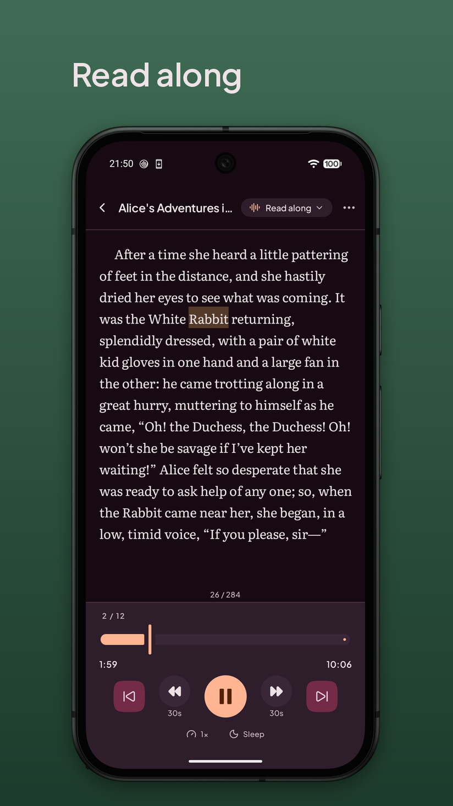
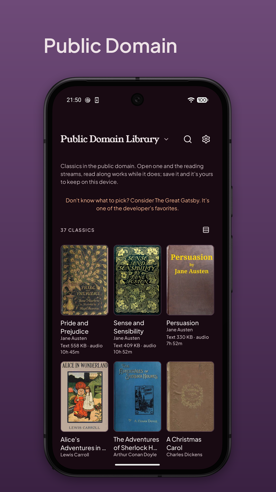

# Cava Reader

An Android ebook reader and audiobook player that highlights each word as the narrator says it.
Bring your own EPUB and audiobook, or start with 37 free classics.

<table>
<tr>
<td></td>
<td></td>
</tr>
</table>

**[cavareader.app](https://cavareader.app)** · **[Google Play](https://play.google.com/store/apps/details?id=dev.micr0.cavareader)** · **[Free classics](https://cavareader.app/classics/)**

Android 8.0 or newer. No account, no ads, no trackers.

## APK downloads

**Obtainium is the recommended way to install the APK without Google Play.** It checks
for new Cava Reader releases automatically and can install updates when auto-update is
enabled, so you do not have to keep checking GitHub or downloading each APK yourself.
Android may still ask you to confirm installation, depending on your device and settings.

### Install with Obtainium (recommended)

[Obtainium](https://github.com/ImranR98/Obtainium) installs Cava Reader directly from this
repository and keeps track of new versions for you.

1. **Install Obtainium** from
   [GitHub](https://github.com/ImranR98/Obtainium/releases) or
   [F-Droid](https://f-droid.org/packages/dev.imranr.obtainium.fdroid/). Either is fine.
2. **Tap "Add App"** and paste this address:

   ```
   https://github.com/cava-reader/releases
   ```

3. **Tap "Add".** Obtainium reads the releases here and picks the build that matches your
   device. Install from there.
4. Leave **auto update** on, or off if you would rather be asked each time. Either way you
   get a notification when a release appears.

Without the Play Store and a Google account.

### Download an APK manually

Prefer a direct download? Open the [latest release](https://github.com/cava-reader/releases/releases/latest),
expand **Assets**, and download the APK for your device. Open the downloaded file to
install it; Android may ask you to allow installs from your browser or file manager.

**A manually installed APK does not update itself.** You will need to return here and
install newer APKs yourself, or add Cava Reader to Obtainium to get automatic update
checks and managed updates. **We recommend Obtainium for ongoing updates.**

---

## Buy Full without Google Play

Cava Reader is free: reading, listening, and the whole Public Domain library with read along included. The **Full** app is the one thing that costs money, a one-time purchase
with no subscription. It lets you use read along for your own books forever, past
the four free hours.

1. **Buy it at [cavareader.app/get](https://cavareader.app/get).** You get a licence key by
   email within a minute or two. No Google account, no Play services.
2. In the app, open the **Full** screen (Settings → About, or any button that mentions the
   free hours).
3. Tap **"Bought on our website? Enter your licence key"**, paste the key, and activate.

A key covers two devices at a time. To move one, deactivate it in the app under
Settings → About, or use the manage link in your purchase email if the old device is gone,
then enter the same key on the new phone. Nothing is charged again.

**Lost your key?** Search your email for the message from our store, or write to the support
at contact@cavareader.app.

---

**Something wrong with the app?** Use the [issue tracker](https://github.com/cava-reader/bug-tracker).
**Anything else?** See [cavareader.app](https://cavareader.app).
